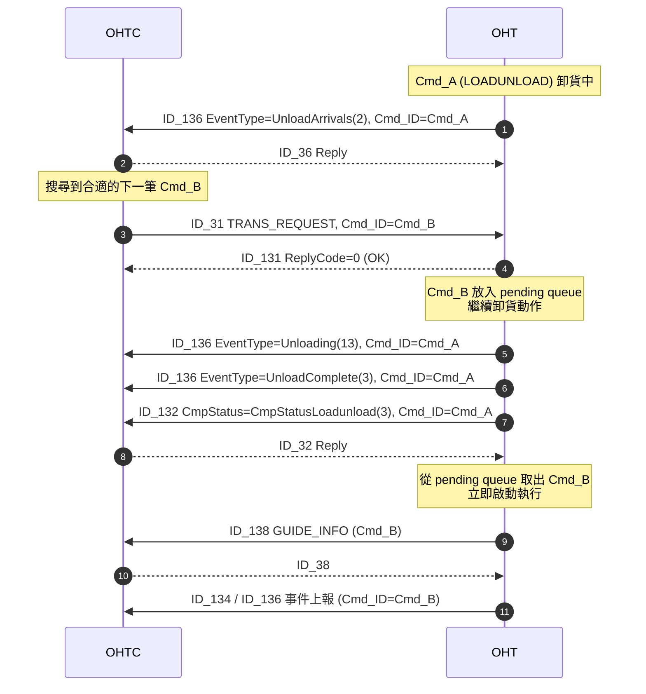
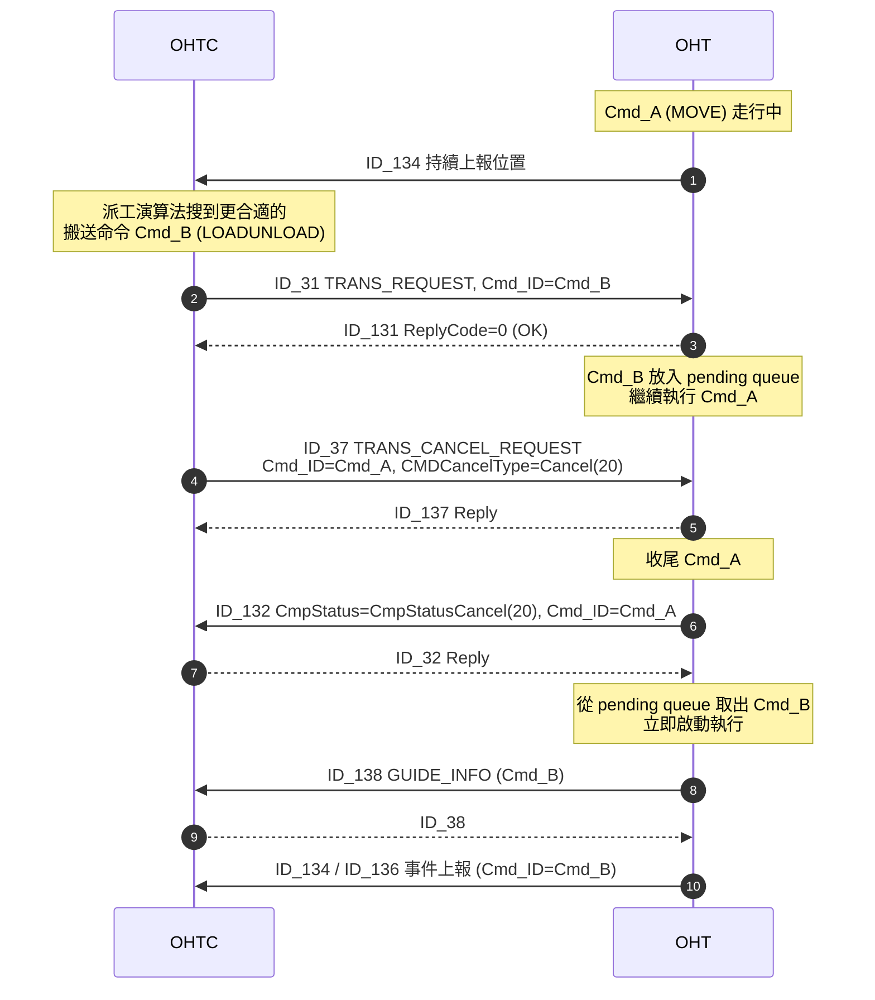
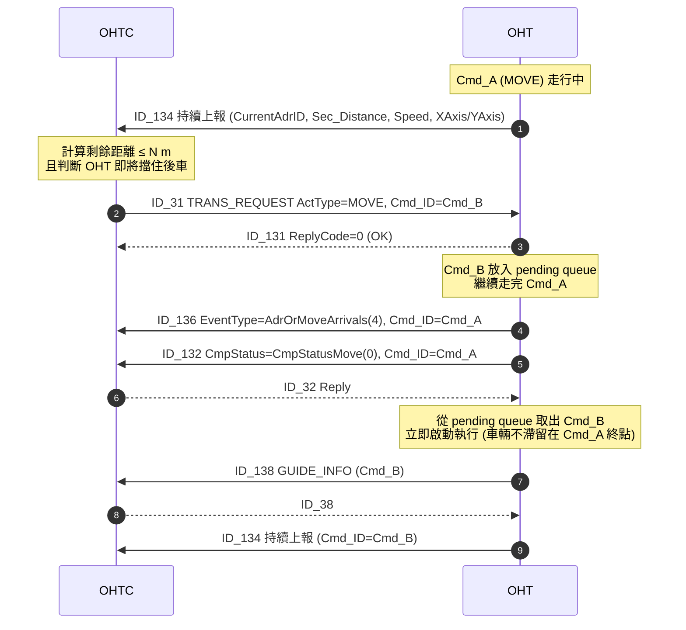
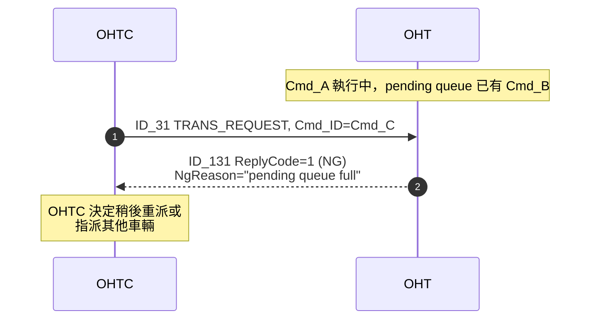

# 命令預下 (Command Pre-Dispatch) 機制設計討論

> **狀態**：設計定稿，待整合進主規格書
> **起草日期**：2026-04-24
> **定稿日期**：2026-04-24
> **預定寫入**：`Mirle_OHT_5th_Communication_Spec.md` 下一版修訂（V1.1.28 草案）

---

## 1. 背景與目的

### 1.1 現行限制
目前 OHTC 對 OHT 的派工是**序列式**：OHT 必須在前一筆命令上報 `ID_132_TRANS_COMPLETE_REPORT` 後，OHTC 才下達下一筆命令。這導致：

- OHT 在卸貨完成後必須**空車回報 → 等待 OHTC 派工 → 再接受命令**才能起步，存在派工空窗期。
- OHT 在執行單純 `Move` 命令途中，即使有新搬送命令更適合他執行，也要等他走到目的地才能切換。
- OHT 在 `Move` 命令接近目的地時，若目的地是一段繁忙路徑上的停等點，OHT 一旦停下容易擋住後車，但 OHTC 又無法在 `ID_132` 之前下新命令讓他繼續走。

### 1.2 新功能目標
賦予 **OHT 在命令執行中接收第二筆命令**的能力，讓 OHTC 可在特定時機「預下」下一筆命令給 OHT，使車輛無縫銜接、減少停等、避免擋路。

---

## 2. 三種預下情境

| 情境 | 觸發時機 (OHTC 端) | 預下的命令類型 | 目的 |
|------|-------------------|--------------|------|
| **A. UnloadArrive 預下** | 收到 `ID_136 EventType=UnloadArrivals(2)` | `ID_31`（多為 LOAD / LOADUNLOAD / MOVE） | 卸貨動作尚在進行時就把下一筆搬送排好，在後續上報 `ID_132 CommandComplete` 後立即起步 |
| **B. Move 中預下搬送** | OHT 正在執行 `ID_31 ActType=MOVE`，OHTC 搜到更合適的搬送命令 | `ID_31`（LOAD / LOADUNLOAD / UNLOAD） | 提前切換 OHT 的執行意圖，避免白跑到原 Move 目的地 |
| **C. Move 接近終點預下 Move** | OHT 的 Move 剩餘距離 ≤ OHTC 內部門檻 `N` m，且 OHTC 判斷他即將擋住後車 | `ID_31 ActType=MOVE`（新的 Move 目的地） | 在車輛即將停下擋住後車前預下，使其可以在上一筆 Move 結束後**不需等待 OHTC 派工**就接下一筆，避免佔用繁忙路徑 |

### 2.1 時序圖

三種情境的 Message 序列如下。共同特徵：預下的 `Cmd_B` 下達後僅放入 OHT 的 pending queue，**不打斷當前 `Cmd_A` 執行**；等 `Cmd_A` 正常收尾（`ID_132`）後，OHT 立即取出 pending 的 `Cmd_B` 啟動執行。

#### 情境 A：UnloadArrive 預下

舊命令 `Cmd_A = LOADUNLOAD` 已到達卸貨點，卸貨動作尚在進行中時由 OHTC 預下 `Cmd_B`。

#### 情境 B：Move 中預下搬送

舊命令 `Cmd_A = MOVE` 走行中，OHTC 的派工演算法搜到更合適的搬送命令 `Cmd_B`。OHTC **先下 `ID_31` 預下 `Cmd_B`**，等 OHT 確認 `ReplyCode=0` 將 `Cmd_B` 放入 pending queue 後，再下 `ID_37` 取消 `Cmd_A`，避免 OHT 白跑到原 Move 目的地。先預下再取消可確保 pending queue 已承接新命令，避免車輛出現無命令的空窗。

#### 情境 C：Move 接近終點預下 Move

舊命令 `Cmd_A = MOVE` 接近終點，OHTC 判斷若 OHT 停下會擋住後車，預下新 `Cmd_B = MOVE`。

#### 拒絕情境（適用於 A / B / C）

若 OHT pending queue 已滿或當前模式不允許，回 NG。

---

## 3. 設計決議

### 3.1 新舊命令的銜接方式

**決議**：三種情境**舊命令皆以既有 `CompleteStatus` 列舉值收尾**，不新增 `Superseded` 類的完成狀態。情境 A / C 走正常完成流程，情境 B 由 OHTC 主動發 `ID_37` 取消舊命令（`CmpStatusCancel(20)`）。

| 情境 | 舊命令收尾方式 |
|------|--------------|
| A | UnloadComplete 後上報 `ID_132 CmpStatus=CmpStatusLoadunload(3)` / `CmpStatusUnload(2)`，OHT 隨即啟動預下命令 |
| B | OHTC 先下 `ID_31` 預下 `Cmd_B`（確認 `ReplyCode=0` 進 pending queue 後），再下 `ID_37 CMDCancelType=Cancel(20)` 取消舊 Move；OHT 上報 `ID_132 CmpStatus=CmpStatusCancel(20)` 後立即啟動預下命令（避免白跑到原 Move 目的地，且避免車輛出現無命令空窗） |
| C | OHT 走到舊 Move 終點上報 `ID_132 CmpStatus=CmpStatusMove(0)`，隨即啟動預下命令 |

> **理由**：沿用既有 `CmpStatus` 列舉值（Move / Unload / LoadUnload / Cancel），可保持 `CompleteStatus` 穩定、避免下游 Report 與 MCS 側相容性改動。情境 B 的 `Cancel` 語意本來就代表「命令執行到一半被 OHTC 主動終止」，正好符合此情境。

> **備註（待 Report 團隊確認）**：
> - 情境 B 會讓 `CmpStatusCancel(20)` 的出現頻率提升（原本多為異常才 Cancel，現會出現在正常派工優化中），需確認 `ErrorCMD` 等公式是否將 Cancel 納入異常計數 —— 若有，需調整成僅計入「非預下取代」的 Cancel。
> - 情境 C 會讓 OHT 累計出多筆「短程 Move 完成」，對 `UtilizationRateByVehicle` 的統計口徑是否造成偏移，需另行評估。
> - 以上均於報表製作討論中評估，本規格不先行調整公式。

### 3.2 OHT 的接收能力與拒絕條件

**決議**：
- OHT 在命令執行中**最多維持 1 筆 pending 預下命令**。
- OHT 收到第二筆 `ID_31` 時，依自身狀態自行判斷是否接受：
  - `ID_131 ReplyCode=0 (OK)`：接受預下命令。
  - `ID_131 ReplyCode=1 (NG)` + `NgReason`：拒絕，原因範例：
    - 已有一筆 pending 的預下命令（容量已滿）。
    - OHT 當前模式不允許（如 Manual、Recovery 中）。

### 3.3 OHT 如何識別「這是預下命令」

**決議**：**不新增旗標欄位、不新增 EventType**。

- `ID_31` 格式維持不變，**OHT 端依自身狀態判斷**：當前已有命令執行中又收到第二筆 `ID_31`，即視為預下命令放入 pending queue。
- 預下命令開始執行的時機，**沿用現有 `ID_136` 事件**（如 LoadArrivals / AdrOrMoveArrivals 等）以新命令的 `Cmd_ID` 上報；OHTC 以 `Cmd_ID` 判別當前 OHT 正在執行哪一筆。
- **不新增 `EventType = PreDispatchStart`**。

### 3.4 情境 C 的「N 公尺」門檻

**決議**：門檻 `N` 為 **OHTC 內部參數**，**不透過 `ID_27/127` 下送給 OHT**。

- OHT 已持續透過 `ID_134` 上報 `CurrentAdrID`、`CurrentSecID`、`Sec_Distance`、`Speed`、`XAxis/YAxis`，OHTC 自行計算剩餘距離。
- 門檻配置、是否分 Section 屬性（彎道 / 直道）等調整皆在 OHTC 側完成，對協議無影響。

### 3.5 情境 B 的「適合他的命令」判斷

屬於 OHTC 派工演算法內部邏輯，不在通訊協議範疇。規格書需註明：
- 預下為 OHTC 端的**優化選擇**，並非每次 Move 都會被預下打斷。
- 是否預下的決策應納入「派工公平性」與「reroute cost」評估。

### 3.6 取消預下命令

**決議**：沿用 `ID_37_TRANS_CANCEL_REQUEST`，以 `Cmd_ID` 指定要取消的是**預下那筆**即可。OHT 收到後從 pending queue 移除，正常繼續當前命令。**無需新增專屬取消機制**。

### 3.7 版本相容性

**決議**：**不新增 Capability Flag**，透過 `ID_25/125 VERSION` 的版本號碼進行功能確認與部署控管，由 OHTC/OHT 版本搭配保證預下功能可用性。

---

## 4. 協議衝擊評估

整體而言本功能**對通訊協議無結構性變更**，僅屬行為語意擴充。

| Message | 修改範圍 |
|---------|---------|
| `ID_31_TRANS_REQUEST` | **不變**。OHT 依自身狀態辨別為預下命令。 |
| `ID_131_TRANS_RESPONSE` | **不變**（`NgReason` 格式不變，僅需於規格註明拒絕預下時可能的原因描述）。 |
| `ID_132_TRANS_COMPLETE_REPORT` | **不變**（`CmpStatus` 沿用既有 ActType 完成值，不新增 Superseded 狀態）。 |
| `ID_134_TRANS_EVENT_REP` | **不變**（現有 Speed / Sec_Distance / XAxis / YAxis 已足供 OHTC 計算剩餘距離）。 |
| `ID_136_TRANS_EVENT_REP` | **不變**（沿用既有 EventType，以 `Cmd_ID` 區分是哪一筆命令的事件）。 |
| `ID_37_TRANS_CANCEL_REQUEST` | **不變**（既有 `Cmd_ID` 指定機制足夠涵蓋預下命令取消）。 |
| `ID_27/127 PARAMETERS` | **不變**（N 公尺門檻為 OHTC 內部參數）。 |

**版本相容性**：透過版本號碼管控部署，不需新增 Capability Flag。

---

## 5. 規格書寫入規劃

- [ ] 於 `Scenario` 章節新增一節：「**Command Pre-Dispatch（命令預下）**」，內容涵蓋：
  - 三種情境的 sequence diagram（A / B / C）。
  - OHT pending queue 的容量限制（1 筆）與拒絕條件列表。
  - 強調 OHTC 派工側為優化選擇而非強制觸發。
  - 取消預下命令沿用 `ID_37` 的說明。
- [ ] 於 `ID_31_TRANS_REQUEST` 屬性說明尾段補註：「若 OHT 當前有命令執行中收到此訊息，則視為預下命令（最多 1 筆 pending），OHT 可依自身狀態決定接受或回 NG」。
- [ ] 於 `ID_131_TRANS_RESPONSE` 的 `NgReason` 描述補充預下情境下的典型拒絕原因。
- [ ] `ProtocolFormat/VehicleMessage.proto` **無需改動**（無結構性變更）。
- [ ] `Document Revision History` 新增一列（`V1.1.28`），註明新增 Command Pre-Dispatch scenario。

---

## 6. 後續協作事項

- [ ] 與 OHT 韌體團隊確認 3.2 的拒絕條件實作細節（Manual / Recovery 模式的判定時機、pending queue 容量已滿時的處理）。
- [ ] 與 OHTC 派工團隊確認 3.5 的演算法介面（門檻 N、派工公平性權重）。
- [ ] **Report 團隊**：3.1 備註指出高頻短程 Move 可能影響 `UtilizationRateByVehicle`、`ErrorCMD`、`TimeOutCMD` 等公式口徑，**後續於報表製作討論中評估**，本規格不先行調整公式。
