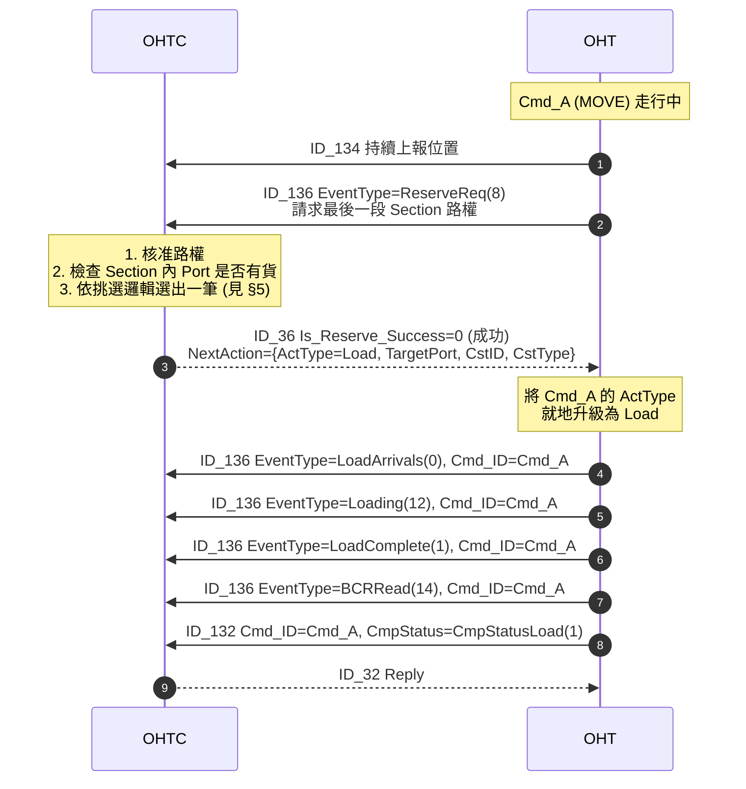
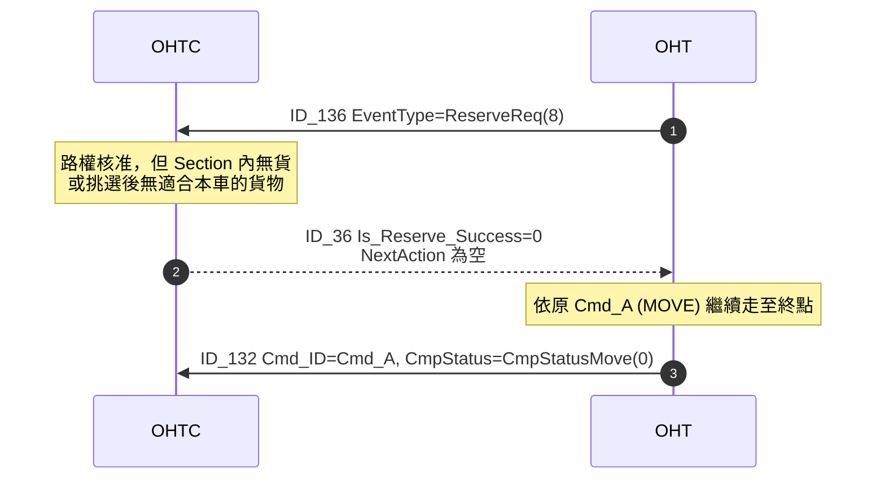

# 路段進入時 Load 動態指派 (In-Section Load Assignment via Reserve Response)

> **狀態**：設計討論中（尚未寫入主規格書）
> **起草日期**：2026-04-24
> **預定寫入**：`Mirle_OHT_5th_Communication_Spec.md` 下一版修訂（與 Command Pre-Dispatch 同版或後續版次）

---

## 1. 背景與目的

### 1.1 現行限制
OHT 執行 `ID_31 ActType=MOVE` 命令走行至目的地時，若途中（尤其是最後一段 Section）的 Port 上有可搬貨物，現行流程必須等 Move 命令完成、OHT 上報 `ID_132` 後，OHTC 才能下一筆 `ID_31 ActType=LOAD`。這存在：

- OHT 走到終點後停車 → 上報 → 等 OHTC 派 Load 命令 → 回頭 / 再度起步取貨，造成繞路與空窗。
- 若 Port 有多筆可搬貨物、又有多台車接近同一 Section，容易發生前車停在近端取貨、擋住後車進入 Section 深處取另一筆貨的情況。

### 1.2 新功能目標
讓 OHTC 在核准 OHT 最後一段 Section 的 Reserve 請求時，**同時挾帶 Load 指派資訊**（沿用既有 `ID_36.NextAction` 欄位，`ActType=Load`），OHT 於進入該 Section 後就地把當前 Move 命令**升級**為 Load，無需等待 Move 完成與額外的 `ID_31`。同時透過挑選邏輯，分散多車至 Section 內不同深度的 Port，避免前車阻塞後車。

> **注意**：`ID_36.NextAction`（`NextActionInfo` 子型別：`ActType / TargetPort / CstID / CstType`）為**既有欄位**（v1.1.18 導入），規格本來就定義了 `ActType=Load` 與 `ActType=Move` 兩種用途。本提案**不修改協議結構**，只新增一個使用 Scenario（旅程最後一段 Section 的 Reserve 核准時機）與其背後的挑選邏輯。

---

## 2. 觸發流程

1. OHT 正在執行 `ID_31 ActType=MOVE`（`Cmd_A`），走行途中持續上報 `ID_134`。
2. OHT 接近旅程最後一段 Section，送 `ID_136 EventType=ReserveReq(8)` 請求該 Section 路權。
3. OHTC 收到後，綜合判斷：
   - 該 Section 的路權是否可核准（`Is_Reserve_Success`）。
   - 該 Section 內是否有 Port 有可搬貨物。
   - 若有多筆貨物、且有多台車即將到達本 Section，依挑選邏輯（見 §5）為本車挑出一筆。
4. OHTC 回 `ID_36`，於路權核准的同時在既有 `NextAction` 欄位填入 Load 指派資訊（`ActType=Load, TargetPort, CstID, CstType`）。
5. OHT 收到後，將當前 `Cmd_A` 的 ActType **就地升級**為 Load，執行取貨。
6. 取貨完成時上報 `ID_132`，`Cmd_ID` 仍為 `Cmd_A`，`CmpStatus=CmpStatusLoad(1)` 反映實際執行結果。

### 2.1 時序圖

#### 無貨可搬 / 不挑選時

---

## 3. 設計決議

### 3.1 Cmd_A 的收尾方式 — 就地升級

**決議**：採**就地升級**，不為 Move 單獨報 `ID_132`。

- `Cmd_A` 的 Cmd_ID 不變，ActType 由 Move 轉為 Load。
- 整段流程只有一筆 `ID_132`，於 Load 完成時上報，`CmpStatus=CmpStatusLoad(1)`。
- OHT 的內部記帳（行走距離 `Cmd_Distance` 等）應涵蓋整段行程。

> **理由**：不新增 Cmd_ID、不產生額外 `ID_132`，對 MCS 側與報表相容性影響最小。語意上 OHT 仍只執行一筆命令，只是命令內容在路權核准時被精緻化。

### 3.2 `NextAction` 欄位沿用既有定義、不帶新 Cmd_ID

**決議**：沿用既有 `NextActionInfo`（`ActType / TargetPort / CstID / CstType`），**不加 Cmd_ID、不加其他欄位**。

- OHT 直接把 `NextAction` 視為對當前 `Cmd_A` 的內容補充，Cmd_ID 沿用。
- OHTC 後續對這筆命令的取消 / 查詢仍以原 Cmd_A 的 Cmd_ID 進行。
- `BOX_ID / LOT_ID` 等既有 Load 命令通常保留空值的欄位，在本情境不帶入（與 `ID_31` 目前實務一致）。

### 3.3 本 Scenario 只使用 ActType=Load

**決議**：本 Scenario（旅程最後一段 Section Reserve 成功時）**只使用 `NextAction.ActType = Load(1)`**。

- 規格既有的 `NextAction.ActType = Move` 用於「路權失敗 + 目的地改變」的另一情境（搭配 `Is_Reserve_Success=1` + `IsAskGuideAgain`），與本 Scenario 不重疊。
- 本 Scenario **不使用** LoadUnload、Unload 等其他類型升級（`NextActionInfo` 結構亦不支援）。
- Load 完成後 OHT 停在 Port，等 OHTC 透過既有流程（或 Pre-Dispatch 機制）派下一筆命令。

### 3.4 OHT 拒絕 NextAction 的處理

**決議**：**OHT 無需回報拒絕**；若 OHT 當下無法執行 Load（如模式不符、異常中），**靜默忽略 `NextAction`**，繼續執行原 Move 命令。

- `ID_36` 為 OHTC→OHT 的 reply，本就無 OHT 端的 ack 訊息，不新增專屬回報機制。
- OHTC 若發現 OHT 未如預期轉 Load（透過後續事件觀察），自行重新派工即可。

> **待確認（OHT 韌體團隊）**：哪些狀況下 OHT 會靜默忽略？建議列出明確條件，便於 OHTC 端觀察與除錯。

### 3.5 與 Command Pre-Dispatch 的互斥

**決議**：OHTC 端保證**兩機制互斥**：

- 若 OHT 已有 Pre-Dispatch pending 的 Cmd_B → OHTC 不會在後續 `ID_36` 挾帶 `NextAction`。
- 若 OHTC 已決定透過 `NextAction` 指派 Load → 不再 Pre-Dispatch 第二筆 `ID_31`。

OHT 端因此永遠只會遇到其中一種情境，毋須處理兩者衝突。

### 3.6 Reserve 失敗時

**決議**：若 `Is_Reserve_Success=1`（失敗），**`NextAction` 必為空**，OHT 忽略。

- `NextAction` 僅在路權核准成功時有效。

---

## 4. 協議衝擊評估

本功能**對通訊協議無結構性變更**。`NextAction` 欄位與 `NextActionInfo` 子型別皆為 v1.1.18 既有定義。

| Message | 修改範圍 |
|---------|---------|
| `ID_36_TRANS_EVENT_RESPONSE` | **不變**（`NextAction` 欄位既有；僅需於描述中補充本 Scenario 的使用時機） |
| `ID_136_TRANS_EVENT_REP` | **不變** |
| `ID_31_TRANS_REQUEST` | **不變** |
| `ID_132_TRANS_COMPLETE_REPORT` | **不變**（`CmpStatus` 沿用既有值，升級後最終上報 `CmpStatusLoad(1)`） |
| `ProtocolFormat/VehicleMessage.proto` | **不變** |

### 4.1 既有 `NextActionInfo` 欄位對照

| 欄位 | 型別 | 本 Scenario 填值 |
|------|------|----------------|
| `ActType` | ActiveType | `Load = 1` |
| `TargetPort` | string | 要取貨的 Port ID |
| `CstID` | string | 要取的 Cassette ID |
| `CstType` | uint32 | Cassette Type（參閱規格 §7.2 各專案 CST Type 定義表） |

> `NextActionInfo` 目前沒有 `BOX_ID / LOT_ID` 欄位（與 `ID_31` 既有 Load 命令不同），故 OHT 端實作 Load 升級時需注意資料來源差異。

### 4.2 版本相容性

透過 `ID_25/125 VERSION` 版本號碼管控部署，OHTC / OHT 版本搭配保證雙方對本 Scenario 的行為語意一致。

---

## 5. 多車多貨的挑選邏輯

當 Section 內有多筆可搬貨物、且有多台車即將到達本 Section 時，OHTC 依以下邏輯分配：

1. **統計即將到來的車數**：找出即將進入本 Section 且已經接近中的車，共 `N` 台。
2. **撈取候選命令**：依 Priority 取出前 `N` 筆可搬載命令（Priority 規則沿用既有派工演算法）。
3. **深度優先分配**：**從 Section 內最遠的貨物**開始，依序分配給即將到來的車輛。

### 5.1 為何最遠優先？

避免**前車停在 Section 近端取貨、擋住後車進入深處取另一筆貨**的情況。分配時讓第一台進入的車直接行駛到深處取貨，後續車輛自然在較近位置取貨，彼此不阻塞。

> **待確認**：
> - 「即將到來」的距離定義（與 Pre-Dispatch 情境 C 的 `N` 門檻是否共用？或各自獨立參數？）
> - Priority 規則是否有 Section 特化調整（例如：距離 Port 過遠的命令是否仍可被本批挑選？）
> - 分配時是否要保證每筆貨都指派到（若 `N > 貨物數` 或 `N < 貨物數`，剩下的車 / 貨如何處理）

---

## 6. 規格書寫入規劃

- [ ] 於 `Scenario` 章節新增一節：「**In-Section Load Assignment（路段進入時 Load 動態指派）**」，內容涵蓋：
  - 觸發流程與時序圖（有 NextAction / 無 NextAction 兩種情形）。
  - 與 Command Pre-Dispatch 的互斥原則。
  - 就地升級的語意（Cmd_ID 不變、CmpStatus 最終為 Load）。
  - 挑選邏輯摘要（§5）。
- [ ] 於 `ID_36_TRANS_EVENT_RESPONSE` 的 `NextAction` 欄位描述**補充本 Scenario**：既有描述涵蓋「ActType=Move 改道」與「ActType=Load 直接取貨」，本次補充 Load 用途中「最後一段 Section Reserve 成功時挾帶指派」的使用時機。
- [ ] 於 `ID_31_TRANS_REQUEST` 屬性說明補註：「若 OHT 執行此命令途中收到 `ID_36 NextAction (ActType=Load)`，可就地升級為 Load（詳見 Scenario 章節）」。
- [ ] `ProtocolFormat/VehicleMessage.proto` **無需改動**。
- [ ] `Document Revision History` 新增一列，註明新增 In-Section Load Assignment scenario（協議欄位無變更）。

---

## 7. 後續協作事項

- [ ] 與 OHT 韌體團隊確認 3.4 的「靜默忽略」條件清單，與 2.1 流程中 Move→Load 就地升級的內部實作（路徑、速度、減速曲線如何銜接）。
- [ ] 與 OHTC 派工團隊補充 §5 挑選邏輯的完整規則（Priority 權重、邊界條件、Fallback）。
- [ ] 與 MCS 側確認：Move 命令結尾 `CmpStatus` 由 Move 變為 Load 是否會影響 MCS 的命令類型追蹤。
- [ ] 與 Report 團隊確認：若 `CmpStatusMove` 出現頻率下降、`CmpStatusLoad` 上升，對 `UtilizationRateByVehicle` 等公式是否造成統計口徑變化（與 `Command_PreDispatch_Design.md` 的 Report 討論一併評估）。
